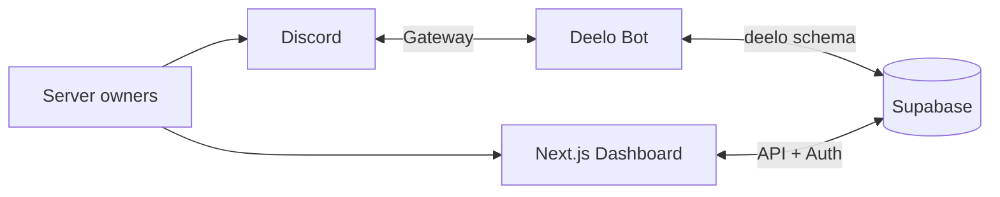

<div align="center">


# Deelo

**The all-in-one Discord community bot** — moderation, security, levels, tickets, music, and a full web dashboard.

[](LICENSE)
[](https://nodejs.org)
[](https://discord.js.org)
[](https://www.typescriptlang.org)
[](https://supabase.com)

<br />

[**Website**](https://web-one-sigma-95.vercel.app) ·
[**Dashboard**](https://web-one-sigma-95.vercel.app/dashboard) ·
[**Commands**](https://web-one-sigma-95.vercel.app/commands) ·
[**Invite Bot**](https://discord.com/oauth2/authorize?client_id=1188001834305060925&permissions=8866461766385655&scope=bot%20applications.commands) ·
[**Status**](https://web-one-sigma-95.vercel.app/status)

<br />

*Freemium plans: **Free** · **Premium** · **Premium+***

</div>

---

## Table of contents

- [Overview](#overview)
- [Features by plan](#features-by-plan)
- [Monorepo layout](#monorepo-layout)
- [Quick start](#quick-start)
- [Setup guide](#setup-guide)
  - [Supabase](#1-supabase)
  - [Discord bot](#2-discord-bot)
  - [Local development](#3-local-development)
  - [Web dashboard](#4-web-dashboard)
- [Freemium system](#freemium-system)
- [Environment variables](#environment-variables)
- [Production notes](#production-notes)
- [License](#license)

---

## Overview

Deelo replaces a stack of single-purpose bots with one toolkit:

| | |
|---|---|
| 🛡️ **Moderation & security** | Ban, kick, warn, timeout, automod, antinuke, antiraid |
| 📈 **Engagement** | XP, levels, giveaways, reaction roles, vanity roles |
| 🎫 **Support** | Ticket panels, forms, transcripts *(Premium)* |
| 🎵 **Music** | Queue, search, and URL playback — audio via yt-dlp (`@discordjs/voice` + `play-dl`) |
| 🎙️ **Voice** | Voicemaster — auto voice channels with join-to-create |
| 🌐 **Dashboard** | Next.js web app for guild settings, admin CMS, OAuth login |

Default prefix: **`,`** — try `,help` after inviting the bot.



---

## Features by plan

| Category | Free | Premium | Premium+ |
|:---------|:----:|:-------:|:--------:|
| **Moderation** | ban, kick, warn, timeout, purge (100), lock/unlock | + nuke, advanced purge (1000) | Same |
| **Security** | automod, basic filters | antinuke, antiraid, fake permissions | Same |
| **Utility** | snipe, editsnipe, afk, avatar, help, poll | + TTS, reactionsnipe | + background removal, makegif |
| **Levels** | XP, rank, leaderboard | + level rewards | Same |
| **Voice** | Voicemaster (basic) | + ghost, music channels | Same |
| **Tickets** | — | Full ticket system | + forms, stats |
| **Music** | Queue (25 songs) | Filters, queue 500 | Queue 1000 |
| **Integrations** | — | Social feeds, ChatGPT | Early access features |
| **Roles** | Reaction roles (1 panel) | Button roles, vanity, booster | Higher limits |

---

## Monorepo layout

```
deelo/
├── src/                    # Discord bot (TypeScript)
│   ├── commands/           # Native commands by category
│   ├── extended/           # Large command catalog + cog handlers
│   ├── handlers/           # Commands, events, buttons
│   ├── services/           # Music, antiraid, voicemaster, …
│   ├── config/plans.ts     # Freemium limits & feature flags
│   └── index.ts            # Bot entry point
├── web/                    # Next.js dashboard + marketing site
├── supabase/migrations/    # Postgres schema (isolated `deelo` schema)
├── docs/                   # GitHub Pages redirect → live site
└── .env.example
```

---

## Quick start

```bash
git clone https://github.com/ape-squared/deelo.git
cd deelo
npm install
cp .env.example .env   # fill in DISCORD_TOKEN + Supabase keys
npm run dev
```

Expected output:

```
Supabase connected
Music service ready (yt-dlp + SoundCloud + Spotify/Apple search)
Loaded 50+ native + 1000+ catalog commands
Deelo logged in as Deelo#1234
```

**Smoke test a few commands:**

```
,help          ,ping          ,premium
,ban @user     ,warn @user     ,rank
,giveaway start 1h 1 Nitro
,voicemaster setup
,play never gonna give you up
```

---

## Setup guide

### Prerequisites

- **Node.js 18+**
- [**Discord bot token**](https://discord.com/developers/applications)
- [**Supabase project**](https://supabase.com) (free tier works)

Enable these **Privileged Gateway Intents** in the Developer Portal:

- Server Members Intent
- Message Content Intent

---

### 1. Supabase

<details>
<summary><strong>Option A — Remote Supabase</strong> <em>(recommended)</em></summary>

1. Create a project at [supabase.com/dashboard](https://supabase.com/dashboard)
2. Open **SQL Editor** → **New query**
3. Run `supabase/migrations/20260706000000_syntax_bot.sql` (creates the `deelo` schema)
4. From **Project Settings → API**, copy:
   - **Project URL** → `SUPABASE_URL`
   - **service_role** key → `SUPABASE_SERVICE_ROLE_KEY` *(server-side only — never expose in the browser)*

</details>

<details>
<summary><strong>Option B — Local Supabase</strong> <em>(offline dev)</em></summary>

```bash
brew install supabase/tap/supabase   # macOS — see docs for other OS
cd deelo
supabase init
supabase start
supabase db reset
```

Use the URL and `service_role` key printed by `supabase start` (typically `http://127.0.0.1:54321`).

</details>

---

### 2. Discord bot

1. Create an application at [discord.com/developers/applications](https://discord.com/developers/applications)
2. **Bot** → create bot → copy token → enable **Server Members** + **Message Content** intents
3. **OAuth2 → URL Generator**:
   - Scopes: `bot`, `applications.commands`
   - Permissions: `Administrator` *(or granular: Manage Channels/Roles, Ban/Kick/Mute, Manage Messages, Connect/Speak)*
4. Invite the bot to your test server

---

### 3. Local development

Edit `.env`:

```env
DISCORD_TOKEN=your_bot_token
OWNER_IDS=your_discord_user_id
SUPABASE_URL=https://xxxxx.supabase.co
SUPABASE_SERVICE_ROLE_KEY=your_service_role_key
DEFAULT_PREFIX=,
```

| Command | Description |
|---------|-------------|
| `npm run dev` | Bot with hot reload (`tsx watch`) |
| `npm run build` | Compile TypeScript → `dist/` |
| `npm start` | Run production build |
| `npm run test:smoke` | Command routing smoke tests |

**Owner testing commands:**

```
,premium activate premium 30    # grant premium for 30 days
,antinuke enable                # requires premium
,tickets panel Support          # requires premium
```

---

### 4. Web dashboard

The `web/` app is a Next.js site deployed on Vercel with guild dashboard, admin CMS, and marketing pages.

```bash
cp web/.env.local.example web/.env.local
npm run web:env          # sync shared keys from root .env
npm run dev:web          # http://localhost:3000
```

| Script | Description |
|--------|-------------|
| `npm run build:web` | Production Next.js build |
| `npm run web:env:prod` | Sync production env template |
| `npm run web:brand` | Process logo assets for dark UI |
| `npm run web:admin` | Create admin login user |

Deploys automatically to Vercel on push to `main` when `web/**` changes (see `.github/workflows/vercel-deploy.yml`).

---

## Freemium system

Plans are stored per-guild in `deelo.guilds.plan`.

| Command | Description |
|---------|-------------|
| `,premium` | View plans and current guild status |
| `,perks` | List enabled features for your plan |
| `,activate premium 30` | Owner-only — test premium without payments |

Plan definitions: `src/config/plans.ts`

**Production payments** — wire up Discord Server Subscriptions, Stripe webhooks, or similar to call `setGuildPlan()` via Supabase / an Edge Function.

---

## Environment variables

### Bot (`.env`)

| Variable | Required | Description |
|----------|:--------:|-------------|
| `DISCORD_TOKEN` | ✅ | Bot token |
| `SUPABASE_URL` | ✅ | Supabase project URL |
| `SUPABASE_SERVICE_ROLE_KEY` | ✅ | Service role key (backend only) |
| `OWNER_IDS` | | Comma-separated owner user IDs |
| `SPOTIFY_CLIENT_ID` | | Optional — resolve Spotify track/album/playlist URLs in `,play` |
| `SPOTIFY_CLIENT_SECRET` | | Optional Spotify API secret *(music URL resolution)* |
| `OPENAI_API_KEY` | | ChatGPT command |
| `DEFAULT_PREFIX` | | Default `,` |

### Web (`web/.env.local`)

See `web/.env.local.example` for Discord OAuth, session secret, and public URLs.

---

## Production notes

- **Music** — YouTube/SoundCloud URLs and optional Spotify link resolution (`@discordjs/voice` + `play-dl` + yt-dlp audio streaming)
- **Schema isolation** — all bot tables live in the `deelo` Postgres schema
- **Translation / TTS** — require external API keys
- **Social feeds** — need a polling worker (cron or Edge Function)
- **Custom domain** — point `deelo.bot` DNS to Vercel; add `https://deelo.bot/api/auth/discord/callback` in the Discord Developer Portal

---

## License

MIT — see [LICENSE](LICENSE).

<div align="center">
  <br />
  <sub>Built for server owners who want one powerful tool — not a bot stack.</sub>
</div>
